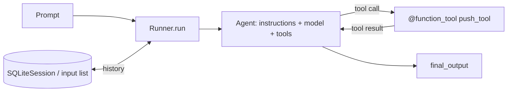
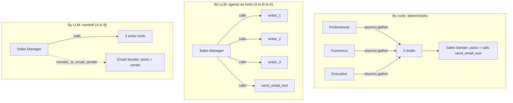
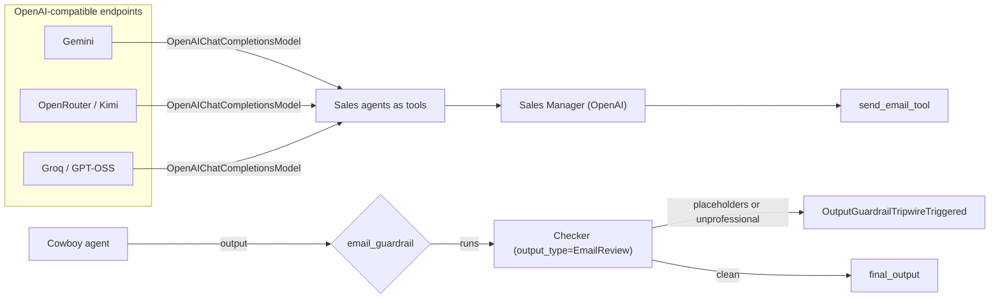
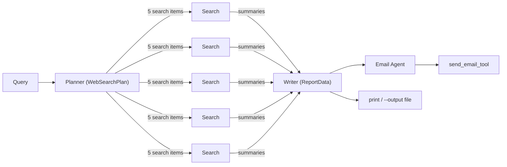

# Agentic AI with the OpenAI Agents SDK

[](../../actions/workflows/ci.yml)

Four progressive, runnable projects that cover the core building blocks of agentic systems with the
[OpenAI Agents SDK](https://openai.github.io/openai-agents-python/): agents and the agent loop, tools, memory,
multi-agent orchestration (by code, agents-as-tools, handoffs), multi-provider models, structured outputs,
guardrails, and an end-to-end Deep Research pipeline.

The code started as the Week 2 notebooks of Ed Donner's *Agentic AI Engineering* course (Udemy). It was refactored into a
reusable package, command-line scripts and an **offline test suite** that exercises the real agent loop against a
scripted fake LLM, so correctness can be verified without any API key or spend.

> **Verify it yourself, no keys needed:** `pip install -r requirements-dev.txt && python -m pytest -q`

---

## Table of contents

1. [What each lab demonstrates](#1-what-each-lab-demonstrates)
2. [Repository layout](#2-repository-layout)
3. [Quick start](#3-quick-start)
4. [Configuration reference](#4-configuration-reference)
5. [Running the labs (CLI reference)](#5-running-the-labs-cli-reference)
6. [Architecture](#6-architecture)
7. [Module reference](#7-module-reference)
8. [Testing](#8-testing)
9. [Design decisions](#9-design-decisions)
10. [Cost and safety notes](#10-cost-and-safety-notes)
11. [Troubleshooting](#11-troubleshooting)
12. [Known limitations](#12-known-limitations)
13. [Extending the project](#13-extending-the-project)
14. [Credits and license](#14-credits-and-license)

---

## 1. What each lab demonstrates

| Lab | Script | Concepts |
|---|---|---|
| 1 | `examples/lab1_basics.py` | `Agent`, `Runner.run`, tracing with `trace()`, streaming events, `@function_tool`, stateless runs vs memory (manual history via `to_input_list()` and `SQLiteSession`) |
| 2 | `examples/lab2_orchestration.py` | Parallel agents with `asyncio.gather`; **orchestration by code**; **agents as tools** (`Agent.as_tool`); **handoffs**; forcing tool use with `ModelSettings(tool_choice="required")` |
| 3 | `examples/lab3_models_guardrails.py` | Any OpenAI-compatible provider (Gemini, OpenRouter, Groq) through `OpenAIChatCompletionsModel`; Pydantic **structured outputs**; **output guardrails** vs an explicit checker call; optional `SandboxAgent` and **MCP** (Context7) demos |
| 4 | `examples/lab4_deep_research.py` | Planner → parallel web searches → writer → emailer pipeline; structured outputs at every stage; hosted `WebSearchTool`; CLI with report export |

**Running example.** Labs 2 and 3 use a fictional company, *ComplAI* (SOC2-compliance SaaS). Three sales agents with
different writing styles (professional, humorous, executive) compete to write the best cold email, and a manager or picker
agent chooses one and "sends" it.

---

## 2. Repository layout

```
.
├── agentic_lab/                  Reusable package (imported by the examples and tests)
│   ├── config.py                 .env loading, model names, provider base URLs, require_env()
│   ├── messenger.py              Notification channels: SMTP email, Pushover, console fallback
│   ├── tools.py                  Shared @function_tool definitions (push_tool, send_email_tool)
│   ├── sales.py                  ComplAI prompts, style agents, manager task text
│   └── deep_research.py          Deep Research schemas, agents and pipeline functions
├── examples/                     One runnable script per lab (python -m examples.<name>)
│   ├── lab1_basics.py
│   ├── lab2_orchestration.py
│   ├── lab3_models_guardrails.py
│   └── lab4_deep_research.py
├── tests/                        Offline test suite (37 tests, no network, no keys)
│   ├── fakes.py                  FakeModel: scripted LLM implementing the SDK's Model interface
│   ├── conftest.py               Fixtures: clean env, tracing off, network guard, fake_llm
│   ├── test_infrastructure.py    config, messenger, tool schemas, .env.example consistency
│   ├── test_lab1_lab2.py         Labs 1-2 end to end
│   └── test_lab3_lab4.py         Labs 3-4 end to end
├── .github/workflows/ci.yml      Runs the tests on Python 3.10 and 3.12
├── .env.example                  Every supported environment variable, documented
├── pyproject.toml                Package metadata and pytest configuration
├── requirements.txt              Runtime dependencies
├── requirements-dev.txt          Runtime + test dependencies
└── LICENSE
```

---

## 3. Quick start

Requires **Python 3.10+**.

```bash
git clone <your-repo-url>
cd agentic-ai-agents-sdk

python -m venv .venv
source .venv/bin/activate            # Windows: .venv\Scripts\activate
pip install -r requirements.txt

cp .env.example .env                 # Windows: copy .env.example .env
# edit .env and set at least OPENAI_API_KEY

python -m examples.lab1_basics
```

Run every command from the repository root. The scripts are modules (`python -m examples.<name>`), not files to execute
from inside `examples/`.

With **only** `OPENAI_API_KEY` set, everything runs: emails and pushes are printed to the console instead of sent, and
optional providers are skipped with a message.

---

## 4. Configuration reference

All configuration is through environment variables, loaded from `.env` by `python-dotenv` (values in `.env` override
variables already set in your shell).

### Credentials

| Variable | Required | Used by | Purpose |
|---|---|---|---|
| `OPENAI_API_KEY` | **Yes** (all labs) | All labs | Default model for every agent, the manager/checker in lab 3, and tracing at platform.openai.com/traces |
| `GOOGLE_API_KEY` | No | Lab 3 | Enables the Gemini sales agent |
| `OPENROUTER_API_KEY` | No | Lab 3 | Enables the OpenRouter (Kimi) sales agent |
| `GROQ_API_KEY` | No | Lab 3 | Enables the Groq (GPT-OSS) sales agent |
| `EMAIL_ADDRESS` | No | Labs 2-4 | SMTP login and both sender and recipient: messages go to yourself |
| `EMAIL_SMTP_SERVER` | No | Labs 2-4 | SMTP host, e.g. `smtp.gmail.com`; connection uses port 587 with STARTTLS |
| `EMAIL_APP_PASSWORD` | No | Labs 2-4 | App-specific password (Gmail: https://myaccount.google.com/apppasswords) |
| `PUSHOVER_USER` | No | Labs 1-4 | Pushover user key |
| `PUSHOVER_TOKEN` | No | Labs 1-4 | Pushover application token |

### Model names

| Variable | Default | Used for |
|---|---|---|
| `MODEL_NAME` | `gpt-5.4-mini` | Every OpenAI-hosted agent |
| `GEMINI_MODEL` | `gemini-3.1-flash-lite` | Gemini sales agent (lab 3) |
| `OPENROUTER_MODEL` | `moonshotai/kimi-k2.6` | OpenRouter sales agent (lab 3) |
| `GROQ_MODEL` | `openai/gpt-oss-120b` | Groq sales agent (lab 3) |

The defaults are the names used in the course. **Confirm they exist on your accounts**; override them in `.env` if not.

### Notification channel selection

`messenger.send_message()` picks the first channel that is **fully** configured:

1. **Email**: all three of `EMAIL_ADDRESS`, `EMAIL_SMTP_SERVER`, `EMAIL_APP_PASSWORD`
2. **Pushover**: both `PUSHOVER_USER` and `PUSHOVER_TOKEN`
3. **Console**: prints the message (always available)

A partially configured channel (for example an address but no password) is treated as not configured and falls through.

---

## 5. Running the labs (CLI reference)

```bash
# Lab 1: agent, tracing, streaming, tool, memory
python -m examples.lab1_basics

# Lab 2: orchestration. Mode is one of: code | tools | handoffs | all (default: all)
python -m examples.lab2_orchestration
python -m examples.lab2_orchestration handoffs

# Lab 3: providers, structured outputs, guardrails
python -m examples.lab3_models_guardrails
python -m examples.lab3_models_guardrails --sandbox   # + SandboxAgent demo (needs ./code, see below)
python -m examples.lab3_models_guardrails --mcp       # + MCP demo via Context7 (network access to mcp.context7.com)

# Lab 4: deep research
python -m examples.lab4_deep_research                                   # default question
python -m examples.lab4_deep_research "Your research question"
python -m examples.lab4_deep_research "..." --no-email --output report.md
```

| Flag | Script | Effect |
|---|---|---|
| `mode` (positional) | lab 2 | Which orchestration pattern(s) to run |
| `--sandbox` | lab 3 | Runs the `SandboxAgent` bug-fixing demo. Create a `./code` directory containing a buggy source file first; fixed files are written to `./output`. Skips with a message if `./code` is missing |
| `--mcp` | lab 3 | Asks a docs question through the Context7 MCP server |
| `--no-email` | lab 4 | Skip the email/push step |
| `--output PATH` | lab 4 | Write the markdown report to `PATH` instead of printing it |

If `OPENAI_API_KEY` is missing, each script exits immediately with a one-line message instead of a stack trace.
Traces for every run appear at https://platform.openai.com/traces.

---

## 6. Architecture

### Lab 1: the agent loop



A run is stateless by default. Memory is added either by passing `result.to_input_list() + [new_message]` back in, or by
passing `session=SQLiteSession(...)` (in-memory by default, or a file path for persistence).

### Lab 2: three ways to orchestrate



| Pattern | Who decides the flow | Control returns? | Trade-off |
|---|---|---|---|
| By code | Your Python | n/a | Predictable and debuggable; fixed workflow |
| Agents as tools | The manager LLM | Yes | Flexible; the manager must follow its prompt |
| Handoff | The manager LLM | No, the receiving agent finishes the run | Cleanest separation; least reliable with small models |

### Lab 3: models, structured outputs, guardrails



Providers without a key are skipped; the manager is built from whichever remain. Two guardrail styles are shown side by
side: the SDK's `@output_guardrail` and a plain explicit `Runner.run(checker, ...)` call.

### Lab 4: Deep Research



Orchestrated by code with one `Runner.run` per stage. Searches run concurrently via `asyncio.gather`. Every stage except
search and email returns a Pydantic model (`WebSearchPlan`, `ReportData`).

---

## 7. Module reference

### `agentic_lab/config.py`

| Name | Description |
|---|---|
| `MODEL_NAME` | Default OpenAI model; from env `MODEL_NAME` |
| `GEMINI_BASE_URL`, `OPENROUTER_BASE_URL`, `GROQ_BASE_URL` | OpenAI-compatible endpoints |
| `GEMINI_MODEL`, `OPENROUTER_MODEL`, `GROQ_MODEL` | Provider model names; overridable from env |
| `require_env(*names)` | Raises `SystemExit` with a clear message listing any unset variables |

Importing this module calls `load_dotenv(override=True)`.

### `agentic_lab/messenger.py`

| Function | Description |
|---|---|
| `email_configured()` / `push_configured()` | True only if **all** required variables for that channel are set |
| `send_email(subject, text_body, html_body)` | Multipart (plain + HTML) message from and to `EMAIL_ADDRESS` over SMTP, port 587, STARTTLS, 30 s timeout |
| `push(message)` | POSTs to the Pushover API; raises on HTTP errors |
| `send_message(subject, text_body, html_body)` | Chooses email → push → console and **returns the channel used** (`"email"`, `"push"` or `"console"`) |

### `agentic_lab/tools.py`

| Tool | Parameters | Behaviour |
|---|---|---|
| `push_tool` | `message: str` | Pushover if configured, otherwise prints to console. Returns a status string to the LLM |
| `send_email_tool` | `subject`, `text_body`, `html_body` (all `str`) | Calls `send_message`; returns `"Message delivered via <channel>"` so the agent can see where it went |

JSON schemas are generated from the type hints and docstrings by `@function_tool`.

### `agentic_lab/sales.py`

| Name | Description |
|---|---|
| `INTRO` | Shared system prompt: sales agent for ComplAI |
| `STYLES` | Mapping of agent name → style instruction (professional, humorous, executive) |
| `EMAIL_TOOL_DESCRIPTION` | Description given to each writer when wrapped with `as_tool` |
| `MANAGER_TASK` | The step-by-step task given to the Sales Manager in lab 2 |
| `build_style_agents(model=MODEL_NAME)` | Returns the three style agents; `model` may be a string or a `Model` object |

### `agentic_lab/deep_research.py`

| Name | Description |
|---|---|
| `WebSearchItem`, `WebSearchPlan`, `ReportData` | Pydantic schemas for structured outputs |
| `HOW_MANY_SEARCHES` | Number of searches the planner is told to produce (default 5) |
| `search_agent`, `planner_agent`, `writer_agent`, `email_agent` | The four agents (search uses `WebSearchTool` with `tool_choice="required"`) |
| `plan_searches(query)` | Runs the planner |
| `search(item)` / `perform_searches(plan)` | One search / all searches concurrently |
| `write_report(query, results)` | Runs the writer |
| `send_report_email(report)` | Runs the email agent |
| `run_research(query, send_email=True)` | Full pipeline inside one `trace("Research trace")`; returns `ReportData` |

### `examples/*`

Each script exposes small async functions (for example `lab2_orchestration.by_code`, `lab3_models_guardrails.guardrails`,
`lab4_deep_research.main`) plus a `__main__` block that parses arguments. This is what lets the tests call the same code
paths the CLI uses.

`lab3_models_guardrails.build_provider_models()` builds one `OpenAIChatCompletionsModel` per provider whose key is set.
`build_sandbox_agent(code_dir, output_dir)` constructs the `SandboxAgent` and `RunConfig` separately from running them so
construction can be tested without a sandbox.

---

## 8. Testing

```bash
pip install -r requirements-dev.txt
python -m pytest -q          # 37 tests, well under a second, no API keys, no network
```

### How it works offline

`tests/fakes.py` defines `FakeModel`, an implementation of the SDK's own `Model` interface driven by a plain function that
receives the system prompt, the full input history, the available tools and handoffs, and the output schema, and returns the
model's response (text and/or tool calls). The **real** `Runner` loop, tool execution, handoff routing, structured-output
parsing, guardrail handling, sessions and streaming all run unchanged. Only the network call to the LLM is replaced.

`conftest.py` additionally:
- clears all credentials and isolates the tests from your real `.env`;
- turns tracing export off;
- **blocks `socket.connect`**, so any accidental real network call fails the test instead of silently spending money;
- provides `fake_llm(respond)`, which routes every string model name (such as `"gpt-5.4-mini"`) to a `FakeModel`.

### What is verified

| Area | Examples of behaviour asserted |
|---|---|
| Config | Missing variables produce a `SystemExit` naming each one; model names are overridable; **every environment variable read in code is documented in `.env.example`** |
| Messenger | Email wins over push, push over console; partial config falls through; SMTP receives host/port 587/STARTTLS/login/From/To/Subject and both plain and HTML bodies; Pushover receives the right payload |
| Tools | Generated JSON schemas have exactly the expected parameters |
| Lab 1 | Tool is actually executed by the agent loop; streaming yields text deltas; a stateless run "forgets" a name while manual history and `SQLiteSession` runs remember it |
| Lab 2 | By code: three drafts reach the picker in one prompt, exactly one email is sent. Tools: the manager has exactly the writer tools plus the sender and collects all three drafts **before** sending. Handoff: manager has no send tool, hands off, and the final output comes from the receiving agent |
| Lab 3 | Providers without keys are skipped; with keys the right endpoint and model are used; structured output parses to a typed `EmailReview` and rejects bad types; the output guardrail trips on placeholders or unprofessional text and passes clean text; the multi-model manager gets one tool per provider and each provider's model is really invoked; sandbox agent builds with its manifest; missing `./code` skips cleanly |
| Lab 4 | Schemas and agent configuration; the planner's searches fan out, every summary reaches the writer, the email is sent once (or not at all with `--no-email`); the CLI writes the report file and prints follow-up questions |

The suite was also checked by deliberately breaking the code (swapping channel priority, removing the handoff, disabling the
guardrail condition, dropping search results before the writer). Each break made a test fail.

### What is *not* verified

The tests prove the **wiring and logic** are correct. They cannot prove that a real model follows your prompts well, that
the default model names exist on your account, that Gmail/Pushover accept your credentials, or that the optional MCP demo can
reach Context7. Those require real keys and are best checked by running the labs once and reading the traces.

---

## 9. Design decisions

- **Package plus thin scripts.** Logic that was duplicated across notebooks (the email tool appeared three times, the sales
  agents twice) lives once in `agentic_lab/`. Scripts only orchestrate and print.
- **Graceful degradation.** Nothing but `OPENAI_API_KEY` is mandatory. The console fallback makes the project demo-able and
  testable without any messaging setup.
- **Orchestration by code vs by LLM.** Both are implemented on the same task so the trade-off is visible: code is predictable;
  LLM orchestration is flexible but needs forced tool use and careful prompts.
- **Explicit checks beside framework guardrails.** The SDK's output guardrail only runs on the final output of the last agent
  in a run, so an explicit checker call is shown next to it as the portable alternative.
- **Dependency injection for testability.** Model objects can be passed into agents and functions
  (`build_style_agents(model=...)`, `multi_model_manager(models)`), which is also what makes mixing providers possible.
- **Emails go to yourself.** The SMTP helper sends from and to `EMAIL_ADDRESS`; there is no recipient list, by design.

---

## 10. Cost and safety notes

- **Lab 4 uses OpenAI's hosted `WebSearchTool`, billed per call.** The default is five searches per run, and OpenAI may bill
  more than one search per call. Lower `HOW_MANY_SEARCHES` in `agentic_lab/deep_research.py` to reduce cost.
- Each lab makes several LLM calls per run; labs 2 and 3 run three writers plus a manager. Use a small model while experimenting.
- Treat `.env` as secret. It is git-ignored; never commit it. Use an **app password**, not your real email password.
- LLM-driven email sending is an action with side effects. Keep the recipient limited to yourself, as implemented, unless you
  add review and approval steps.

---

## 11. Troubleshooting

| Symptom | Likely cause and fix |
|---|---|
| `Missing environment variables: OPENAI_API_KEY` | Create `.env` from `.env.example` and set the key; run from the repository root |
| `ModuleNotFoundError: agentic_lab` / `examples` | Run with `python -m examples.<name>` from the repository root |
| `model not found` / 404 from a provider | The default model name is not available to your account; set `MODEL_NAME`, `GEMINI_MODEL`, `OPENROUTER_MODEL` or `GROQ_MODEL` in `.env` |
| Output prints `[console] Subject: ...` instead of sending | Email and Pushover are not (fully) configured; set all three email variables or both Pushover variables |
| `SMTPAuthenticationError` | Use a Gmail **app password** (requires 2-step verification), not your account password |
| Mail not in inbox | Check spam; the content is, after all, a cold sales email |
| Lab 2 handoff or manager does not send | Orchestration by LLM is probabilistic, especially with small models. Check the trace, tighten the prompt, or use a larger model |
| Lab 3 only runs the OpenAI parts | No `GOOGLE_API_KEY` / `OPENROUTER_API_KEY` / `GROQ_API_KEY` set; providers without keys are skipped by design |
| `--sandbox` prints "skipping" | Create a `./code` directory with a buggy file; the sandbox needs macOS, Linux, or Windows with WSL2 |
| Tests fail with "Network access attempted" | A code path is calling out for real; that is the guard doing its job. Mock it in the test |

---

## 12. Known limitations

- Live behaviour against real providers is not covered by automated tests (see [What is not verified](#what-is-not-verified)).
- Default model identifiers are taken from the course material and may need changing for your account.
- The sandbox and MCP demos are optional extras that depend on platform support and network access.
- Email is SMTP-to-self only: no replies, threading or bounce handling.
- Prompts are intentionally simple demonstration prompts, not evaluated or tuned.

---

## 13. Extending the project

- Add an **input guardrail** and a **tool guardrail** next to the existing output guardrail.
- Add a **refinement loop**: draft → critique → revise, orchestrated by code, then compare with LLM orchestration.
- Use **structured outputs for the email drafts** themselves (subject, body, call to action) instead of free text.
- Replace SMTP with **SendGrid or Resend** and handle replies so the sales agent can continue the conversation.
- Replace `WebSearchTool` with a free search API wrapped as a `@function_tool` to remove the per-search cost.
- Add an **evaluation harness** that scores drafts or reports with a judge model across several providers.

---

## 14. Credits and license

Based on the course material by [Ed Donner](https://www.linkedin.com/in/eddonner/) (*Agentic AI Engineering*, Udemy).
Refactoring, package structure, CLI, configuration layer, documentation and test suite were added on top.

Released under the MIT License (see `LICENSE`). Check the original course repository's license before redistributing any
course material beyond what is here.
